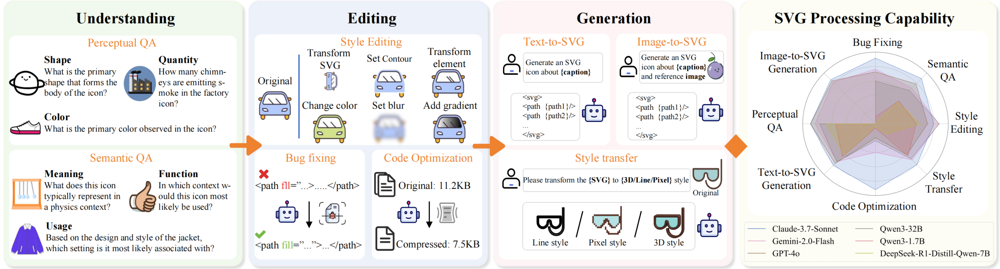
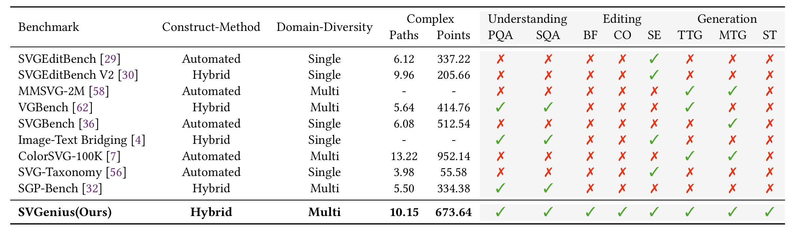
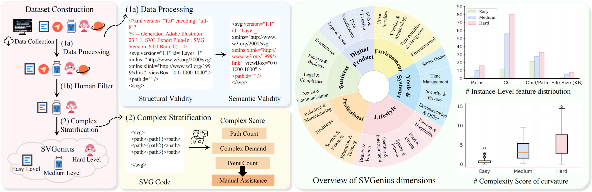

<h2><i>SVGenius</i>: Benchmarking LLMs in SVG Understanding, Editing and Generation</h2>

<div align="center">
    <a href="https://arxiv.org/abs/2506.03139" target="_blank">
        
    </a>
    <a href="https://huggingface.co/datasets/xiaoooobai/SVGenius" target="_blank">
        
    </a>
    <a href="https://zju-real.github.io/SVGenius/" target="_blank">
        
    </a>
</div>

## 🔥🔥🔥 News !!

- [2025/08/01] 👋 We are happy our paper was accepted to ACM MM 2025.
- [2025/05/30] 👋 Release Datasets. 🤗[Dataset](https://huggingface.co/datasets/xiaoooobai/SVGenius).
- [2025/05/30] 👋 Unpload paper. [Arxiv](https://arxiv.org/abs/2506.03139).
- [2025/05/31] 👋 Release the evaluation code. [Code](https://github.com/ZJU-REAL/SVGenius/tree/main/src)

## 🌟 Overview

SVGenius evaluates (M)LLMs capabilities across three progressive dimensions: **Understanding** (perceptua and semantic QA), **Editing** (bug fixing, code optimization, style editing), and **Generation** (text-to-SVG, image-to-SVG, style transfer).  Built on real-world data from **24** application domains with systematic complexity stratification, SVGenius evaluates models through **8** task categories and **18** metrics. We assess **22** mainstream models spanning different scales, architectures, training paradigms, and accessibility levels.




Comparison of SVGenius with existing SVG processing benchmarks. 



## ✨ Data Construct

Current SVG benchmarks face critical limitations in data quality and diversity.To address these limitations, we construct a comprehensive dataset with principled complexity stratification as show in the following figure: Left: systematic pipeline from data collection, processing, human filtering to complexity stratification. Center: 24-domain coverage across diverse applications. Right: validation of complexity stratification showing clear hierarchical separation across Easy, Medium, and Hard levels through feature distributions and complexity scores.



## 📊 Benchmark Statistics

🧪 Model Evaluation
We evaluate a diverse set of models on SVGenius to assess SVG processing capabilities across different architectures, scales, and training paradigms:

🔒 Proprietary Models: GPT-4o, Gemini-2.0-Flash, Claude 3.7-Sonnet  
🌐 Open-Source Models: Representative models spanning 1.5B to 72B parameters （16 models）  
🎨 SVG-Specialized Systems: Iconshop, StarVector, LLM4SVG  

*Detailed results available in the [supplementary materials](./supplementary/supplementary.pdf).*

## 📁 QucikStart

```
SVGenius/
├── 📂 docs/                    # Project page source code
├── 📂 src/                     # Main source code
│   ├── 📂 data/                # Processed stratified SVGs
│   ├── 📂 tasks/               # Samples from 8 task categories
│   ├── 📂 understanding/       # Evaluation code for understanding dimensions
│   ├── 📂 editing/             # Evaluation code for editing dimensions
│   ├── 📂 generation/          # Evaluation code for generation dimensions
│   ├── 📂 metrics/             # Shared evaluation metrics
│   └── 📄 eval_util.py         # Utility functions for evaluation
├── 📂 supplementary/           # Includes data construction, task definitions, metrics, and more
├── 📄 requirements.txt         # Dependencies for evaluation
└── 📄 README.md                
```

## 🧪 Usage

This section demonstrates how to test different tasks using our evaluation scripts. Here we use SVG Bug Fixing as an example.

**I. Environment Setup.**

```py
# Clone the repository
git clone https://github.com/ZJU-REAL/SVGenius.git
cd SVGenius

# Create a new environment
conda create -n svg_ben python=3.10
conda activate svg_ben

# Install dependencies
pip install -r requirements.txt
```

**II. Configure API Settings.**

Set your API credentials in the respective evaluation script (e.g., src/editing/bug_fixing/evaluation.py).

```py
API_KEY = "your_api_key_here"
BASE_URL = "your_base_url_here"
```

**III. Run Evaluation (Bug Fixing Example).**

Test cases are provided in src/tasks/editing/bug_fixing/ directory.

```py
cd src/editing/bug_fixing

# Run evaluation with test cases
python evaluation.py \
  --input ../tasks/editing/bug_fixing/test_samples.json \
  --output results.json \
  --model deepseekr1
```

The evaluation generates comprehensive metrics including repair accuracy, processing time, and change magnitude for performance assessment. Similar testing procedures can be applied to other tasks with their respective evaluation scripts.


## Citation

```bibtex
@misc{chen2025svgeniusbenchmarkingllmssvg,
      title={SVGenius: Benchmarking LLMs in SVG Understanding, Editing and Generation}, 
      author={Siqi Chen and Xinyu Dong and Haolei Xu and Xingyu Wu and Fei Tang and Hang Zhang and Yuchen Yan and Linjuan Wu and Wenqi Zhang and Guiyang Hou and Yongliang Shen and          Weiming Lu and Yueting Zhuang},
      year={2025},
      eprint={2506.03139},
      archivePrefix={arXiv},
      primaryClass={cs.CV},
      url={https://arxiv.org/abs/2506.03139}, 
}
```
